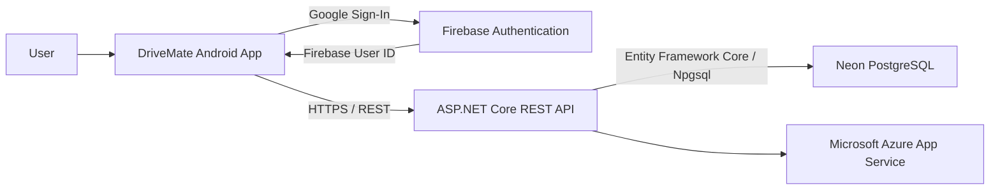

# DriveMate

DriveMate is a native Android vehicle management application developed for the PROG7314 Portfolio of Evidence.

The application provides South African drivers with a central place to manage their vehicles, monitor maintenance, track running costs, receive licence-renewal information, and securely access their vehicle data.

DriveMate uses a native Kotlin Android client together with a custom ASP.NET Core REST API, Firebase Authentication, Microsoft Azure App Service, and a Neon PostgreSQL cloud database.

---

## Team

| Team Member | Main Responsibility |
|---|---|
| Mikhaeel Mahomed | Project integration, Google SSO, vehicle management, South African vehicle localisation, REST API, Azure deployment, Neon database integration, testing, CI/CD and final integration |
| Mangaliso | Vehicle Health and Maintenance feature |
| Theolin | Running Costs calculation logic, models and unit testing |
| Julian | Application Settings, language and biometric functionality |

---

## Key Features

### Google Sign-In

DriveMate supports Google Sign-In using Firebase Authentication, Android Credential Manager and Google Identity Services.

Users authenticate using their Google account and the Firebase user ID is used to associate application data with the signed-in user.

---

### Vehicle Management

Users can:

- Add vehicles.
- View saved vehicles.
- Store vehicle make, model and year.
- Store South African registration numbers.
- Record fuel type.
- Record odometer mileage.
- Track vehicle licence renewal dates.
- View licence-renewal status and warnings.

Vehicle information is persisted through the custom DriveMate REST API and Neon PostgreSQL database.

---

### South African Vehicle Localisation

DriveMate includes functionality designed specifically around South African vehicle ownership.

This includes:

- South African registration number support.
- Vehicle licence-renewal tracking.
- Renewal status warnings.
- Kilometre-based odometer readings.
- Fuel quantities in litres.
- Fuel consumption in litres per 100 km.
- South African Rand (ZAR) currency formatting.

---

### Vehicle Health and Maintenance

The Vehicle Health feature allows users to manage maintenance information for their vehicles.

Maintenance records support:

- Services.
- Repairs.
- Inspections.
- Vehicle pick-up related records.
- Other maintenance activities.
- Mileage.
- Cost.
- Notes.
- Upcoming maintenance reminders.
- Completed maintenance.
- Maintenance history.
- Record deletion.

Maintenance records are persisted through the REST API and Neon PostgreSQL.

---

### Running Costs

DriveMate provides vehicle-specific running-cost tracking.

Users can record:

- Fuel purchases.
- Fuel quantity in litres.
- Price per litre.
- Total fuel cost.
- Odometer readings.
- Full or partial tank fill-ups.
- General vehicle expenses.
- Expense categories.
- Expense descriptions.

The Running Costs feature calculates:

- Total running cost.
- Total fuel expenditure.
- Total litres purchased.
- Average fuel price per litre.
- Estimated fuel consumption in L/100 km.
- Total non-fuel expenses.
- Expense information for the selected vehicle.

Running-cost records are persisted through the REST API and Neon PostgreSQL.

---

### App-Wide Language Localisation

DriveMate supports three application languages:

- English (UK)
- Afrikaans
- isiZulu

The selected language applies throughout the application's main user-facing workflow, including:

- Vehicle management.
- Add Vehicle.
- Vehicle Health and Maintenance.
- Running Costs.
- Settings.
- Authentication screens.
- Validation and status messages.
- Biometric authentication text.

The selected language is retained between application sessions.

---

### Settings and Biometrics

DriveMate includes a Settings screen that provides access to account, language and security functionality.

Users can:

- View signed-in account information.
- Select the application language.
- Check biometric availability.
- Open Android biometric enrolment when required.
- Authenticate using Android's secure biometric prompt.

Biometric authentication uses AndroidX Biometric with strong biometric authentication where supported by the device.

---

## Screenshots

### App-Wide Localisation

| English | Afrikaans | isiZulu |
|---|---|---|
|  |  |  |

Additional application and testing screenshots may be added to the `docs/screenshots` directory.

---

## Technology Stack

### Android Application

- Kotlin
- Jetpack Compose
- Android Credential Manager
- Google Identity Services
- Firebase Authentication
- Retrofit
- Gson
- Kotlin Coroutines
- StateFlow
- Android ViewModel
- AndroidX Biometric
- Android locale APIs
- JUnit
- Gradle

### Backend

- ASP.NET Core
- .NET 10
- Entity Framework Core
- PostgreSQL
- Npgsql

### Cloud Services

- Microsoft Azure App Service
- Neon PostgreSQL
- Firebase Authentication

### Development and DevOps

- Git
- GitHub
- GitHub Actions
- Android Studio
- Visual Studio Code
- Gradle
- .NET CLI

---

## System Architecture

DriveMate follows a client-server architecture.



### Data Flow

1. The user signs in using Google.
2. Firebase Authentication provides the authenticated user identity.
3. The Android application uses the Firebase user ID to associate user-specific data.
4. Retrofit sends HTTPS requests to the DriveMate ASP.NET Core REST API.
5. The API processes requests using Entity Framework Core.
6. Data is persisted in Neon PostgreSQL.
7. API responses are returned to the Android application and displayed using Jetpack Compose.

---

## REST API

The custom DriveMate REST API provides endpoints for the application's cloud-backed functionality.

### Vehicles

| Method | Endpoint | Purpose |
|---|---|---|
| POST | `/api/vehicles` | Create a vehicle |
| GET | `/api/vehicles/user/{firebaseUserId}` | Retrieve a user's vehicles |

### Maintenance

| Method | Endpoint | Purpose |
|---|---|---|
| POST | `/api/maintenance` | Create a maintenance record |
| GET | `/api/maintenance/user/{firebaseUserId}` | Retrieve maintenance records |
| PUT | `/api/maintenance/{id}` | Update a maintenance record |
| DELETE | `/api/maintenance/{id}` | Delete a maintenance record |

### Fuel Entries

| Method | Endpoint | Purpose |
|---|---|---|
| POST | `/api/fuel-entries` | Create a fuel entry |
| GET | `/api/fuel-entries/user/{firebaseUserId}` | Retrieve fuel entries |
| PUT | `/api/fuel-entries/{id}` | Update a fuel entry |
| DELETE | `/api/fuel-entries/{id}` | Delete a fuel entry |

### Expenses

| Method | Endpoint | Purpose |
|---|---|---|
| POST | `/api/expenses` | Create an expense |
| GET | `/api/expenses/user/{firebaseUserId}` | Retrieve expenses |
| PUT | `/api/expenses/{id}` | Update an expense |
| DELETE | `/api/expenses/{id}` | Delete an expense |

---

## Cloud Deployment

The DriveMate backend is deployed using Microsoft Azure App Service.

The production architecture is:

```text
Android App
    |
    | HTTPS
    v
Azure App Service
ASP.NET Core REST API
    |
    | Entity Framework Core
    v
Neon PostgreSQL
```

Azure provides the hosted API while Neon provides the persistent PostgreSQL database.

Database schema changes are managed using Entity Framework Core migrations.

---

## Data Persistence

DriveMate stores cloud-backed records in PostgreSQL rather than relying only on temporary Android application state.

The following application data is persisted:

- Vehicles.
- Maintenance records.
- Fuel entries.
- Vehicle expenses.

This allows records to remain available after the Android application is closed and reopened.

---

## Testing

DriveMate contains automated tests for both the Android application and ASP.NET Core backend.

### Android Tests

Android unit tests cover functionality including:

- Vehicle licence-renewal calculations.
- Running Costs calculations.
- Fuel-cost calculations.
- Fuel-consumption calculations.
- Expense calculations.

Run Android tests with:

```powershell
.\gradlew test
```

Build the Android application with:

```powershell
.\gradlew assembleDebug
```

### API Tests

Backend tests cover vehicle validation and API-related business rules.

Run API tests with:

```powershell
dotnet test api-tests/DriveMate.Api.Tests.csproj
```

Build the API with:

```powershell
dotnet build api/DriveMate.Api.csproj
```

---

## Continuous Integration

DriveMate uses GitHub Actions to automatically verify the project on repository pushes.

The workflow is located at:

```text
.github/workflows/drivemate-ci.yml
```

The CI pipeline performs:

- Android dependency setup.
- Android compilation.
- Android unit testing.
- ASP.NET Core dependency restore.
- ASP.NET Core compilation.
- API unit testing.

This helps identify build or test failures before code is integrated into the final project.

---

## Android Logging

DriveMate uses Android's `Log` API to provide development and debugging information.

Logging is used for areas including:

- Application startup.
- Firebase session detection.
- Google authentication.
- API health checks.
- Cloud database communication.
- Vehicle loading and saving.
- Screen navigation.
- Error handling.

Examples of logging tags used by the application include:

```text
DriveMateApp
DriveMateAuth
DriveMateApi
DriveMateCloud
DriveMateVehicle
```

Technical exceptions are logged while user-facing errors are displayed using translated application messages.

---

## Version Control

The project uses Git and GitHub for collaborative development.

Development was separated into feature branches before integration into the shared development branch.

Examples include:

```text
feature/google-sso
feature/api-cloud-integration
feature/sa-vehicle-localisation
feature/vehicle-maintenance
feature/running-costs
feature/settings
feature/github-actions
feature/android-logging
feature/api-unit-tests
feature/full-localisation
```

This approach allowed features to be developed, tested and integrated independently.

---

## Running the Project

### Requirements

To run the Android project:

- Android Studio.
- Android SDK.
- JDK compatible with the project's Gradle configuration.
- An Android emulator or physical Android device.
- Internet access for Firebase Authentication and the cloud API.

To run the backend locally:

- .NET 10 SDK.
- PostgreSQL-compatible database connection.
- The required database connection string.

---

### Android Application

Clone the repository and open it in Android Studio.

From the repository root:

```powershell
.\gradlew assembleDebug
```

The generated debug APK can be found under:

```text
app/build/outputs/apk/debug/app-debug.apk
```

The Android application requires the Firebase configuration contained in the application's Firebase setup.

---

### ASP.NET Core API

Restore and build the backend:

```powershell
dotnet restore api/DriveMate.Api.csproj
dotnet build api/DriveMate.Api.csproj
```

Run the API locally:

```powershell
dotnet run --project api/DriveMate.Api.csproj
```

A database connection string must be configured securely before running the API locally.

Sensitive connection strings must not be committed to the repository.

---

## Database Migrations

Entity Framework Core migrations are stored under:

```text
api/Migrations
```

The project includes migrations for:

- Initial cloud database setup.
- Vehicle storage.
- Maintenance records.
- Running Costs records.

Database migrations can be applied using the Entity Framework Core tooling when a valid database connection is configured.

---

## Security Considerations

DriveMate uses several security-related practices:

- Google SSO rather than custom password storage.
- Firebase Authentication for user identity.
- Android Credential Manager for Google sign-in.
- AndroidX Biometric for biometric authentication.
- HTTPS communication with the hosted API.
- Cloud database connection strings are kept outside application source code.
- Firebase user IDs are used to associate records with signed-in users.
- Sensitive secrets must not be committed to Git.

---

## Demonstration Video

The final demonstration video will show:

- Google Sign-In.
- Vehicle creation and retrieval.
- Cloud persistence.
- South African vehicle localisation.
- Vehicle Health and Maintenance.
- Running Costs.
- English, Afrikaans and isiZulu localisation.
- Settings and biometric authentication.
- Azure-hosted API functionality.

**Demo video:** https://youtu.be/MQ3CaVZrE0g

---

## Project Structure

```text
.
├── .github/
│   └── workflows/
│       └── drivemate-ci.yml
├── api/
│   ├── Data/
│   ├── Migrations/
│   ├── Models/
│   ├── Services/
│   ├── DriveMate.Api.csproj
│   └── Program.cs
├── api-tests/
│   ├── DriveMate.Api.Tests.csproj
│   └── VehicleValidatorTests.cs
├── app/
│   └── src/
│       ├── main/
│       └── test/
├── docs/
│   └── screenshots/
├── README.md
├── build.gradle.kts
└── settings.gradle.kts
```

---

## Project Summary

DriveMate combines a native Kotlin Android application with a custom cloud-hosted ASP.NET Core backend.

The project demonstrates:

- Native Android development using Kotlin and Jetpack Compose.
- Google SSO and Firebase Authentication.
- Custom REST API development.
- Cloud deployment using Microsoft Azure.
- PostgreSQL persistence using Neon.
- South African vehicle-specific functionality.
- Maintenance management.
- Vehicle running-cost calculations.
- App-wide multilingual support.
- Biometric authentication.
- Automated Android and backend testing.
- GitHub Actions continuous integration.
- Collaborative Git-based development.
